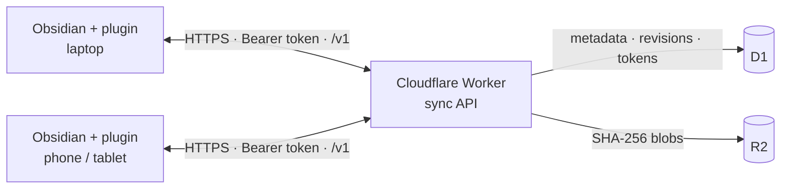

# Obsidian Distributed Sync

**Self-hosted, conflict-safe sync for your Obsidian vault.**

[](https://github.com/Developits/Obsync/actions/workflows/validate.yml)
[](https://github.com/Developits/Obsync/releases/latest)
[](LICENSE)
[](https://nodejs.org)

Distributed Sync is an Obsidian plugin plus a Cloudflare Worker backend that keeps your vault synchronized across devices without handing your notes to a third-party sync service. Metadata lives in Cloudflare D1, file bytes live in R2 as SHA-256-addressed blobs, and every client talks to your Worker over HTTPS.

> **Status:** v1.0.1. Self-hosted and actively hardened, but not yet listed in the Obsidian community plugin gallery. Start with a disposable test vault and a staging Worker before trusting a primary vault.

## Why this exists

| Goal | How it works |
|---|---|
| **You own the server** | The Worker, D1 database, and R2 bucket run in your own Cloudflare account. There is no vendor account, subscription, or shared backend. |
| **Conflicts are preserved, not guessed** | Non-overlapping Markdown edits merge automatically with a three-way Myers diff. Overlapping or binary edits become sibling conflict files attributed to the remote device; nothing is silently overwritten. |
| **No lost updates** | Every write carries `X-Base-Rev` and is checked against the current revision inside an atomic D1 batch. A stale client gets an explicit conflict instead of overwriting newer data. |
| **Incremental, not full-vault uploads** | Clients pull a `seq`-ordered delta feed and fetch only the blobs they do not already have. Downloads support HTTP byte ranges. |
| **Serverless and cheap to run** | Designed for Cloudflare Workers, D1, and R2; the free tiers are usually enough for a personal vault. |

## Features

- Multi-device sync of notes and attachments, including renames and deletions.
- Three-way line merge for text; clean merges converge automatically.
- Conflict copies for overlapping edits and binary files, with no overwrite of earlier conflict copies.
- Revision-aware downloads (`GET /v1/file?rev=…`), tombstones, and configurable retention (0–36,500 days).
- Device tokens hashed with SHA-256; first enrollment gated by a bootstrap secret.
- Token minting from an already-authorized device, so adding a phone or tablet does not require the bootstrap secret.
- Local-only diagnostics export with no note content, paths, tokens, or server URLs.
- Auto-sync with a configurable interval, status bar, ribbon button, and command palette actions.
- Strict server validation: NFC vault-relative paths, traversal rejection, bounded integers, and single-range requests only.

## Architecture



| Component | Responsibility |
|---|---|
| `plugin/` | Obsidian plugin (TypeScript). Indexes the vault, watches file events, reconciles, merges, and pushes. |
| `server/` | Worker API (TypeScript). Authentication, path validation, revision checks, D1 transactions, R2 storage, retention. |
| `test/` | Node regression suites plus a real local `workerd`/D1/R2 smoke test. |
| `scripts/` | Deterministic release packaging for Obsidian and BRAT. |

## How a sync works

1. The client scans the vault and compares it with its persisted local index.
2. It pulls `GET /v1/changes?since=<seq>` in pages. The feed is a latest-state delta, not an immutable event log.
3. For each changed path, the client chooses an action:
   - remote-only change → download and apply;
   - local-only change → upload;
   - both changed → three-way merge, or preserve a conflict copy.
4. Uploads and deletes send `X-Base-Rev`. The Worker checks the expected revision and publishes the new revision, metadata, and `seq` atomically in one D1 batch. Rejected attempts can leave harmless gaps in `seq`.
5. The client advances its checkpoint only after fully consuming a pull page. A write acknowledgment alone does not advance it.

Blobs are content-addressed: the R2 key is derived from the SHA-256 of the bytes, so identical content is stored once and never mutated in place.

## Quick start

### 1. Deploy the Worker

Requirements: Node.js 24+, a Cloudflare account, and Wrangler (installed as a project dependency).

```bash
git clone https://github.com/Developits/Obsync.git
cd Obsync
npm ci --prefix server --ignore-scripts
npm ci --prefix plugin --ignore-scripts

cd server
npx wrangler login
npx wrangler d1 create obsidian-sync-db
npx wrangler r2 bucket create obsidian-sync-blobs
```

Copy the returned D1 `database_id` into `server/wrangler.jsonc`. The repository ships with an ID from the author's account; replace it rather than assuming it points at your database.

```bash
# Apply the schema to the new database.
npx wrangler d1 execute obsidian-sync-db --remote --file=./schema.sql

# Set the one-time enrollment secret, then deploy.
npx wrangler secret put API_KEY
npx wrangler deploy
```

> Do not run resource-creation or schema commands against an existing deployment without checking its resources and backups first.

### 2. Mint the first device token

The bootstrap secret is only needed for the first device; afterward, an authorized device can mint tokens for the others.

```bash
read -r -s -p 'Bootstrap secret: ' OBSYNC_BOOTSTRAP_KEY; printf '\n'
curl --fail-with-body -X POST 'https://YOUR-WORKER.workers.dev/v1/tokens' \
  -H 'Content-Type: application/json' \
  -H "X-Api-Key: $OBSYNC_BOOTSTRAP_KEY" \
  -d '{"name":"Laptop"}'
unset OBSYNC_BOOTSTRAP_KEY
```

The response contains a sensitive device token. Store it in the plugin settings; never commit it or paste it into an issue.

### 3. Install the plugin

Download the assets from the [latest release](https://github.com/Developits/Obsync/releases/latest), then choose one option:

- **Manual (versioned zip).** `obsidian-distributed-sync-vX.Y.Z.zip` contains the `obsidian-distributed-sync/` folder. Extract it into `YOUR_VAULT/.obsidian/plugins/`.
- **Manual (flat zip).** `obsidian-distributed-sync-flat.zip` contains `main.js` and `manifest.json` at the root. Extract it into `YOUR_VAULT/.obsidian/plugins/obsidian-distributed-sync/`.
- **BRAT.** Install [BRAT](https://github.com/TfTHacker/obsidian42-brat), choose *Add Beta Plugin*, and enter `Developits/Obsync`.

Enable **Distributed Sync** under *Settings → Community plugins*, then open its settings:

| Setting | What to enter |
|---|---|
| Server URL | Your deployed Worker URL, e.g. `https://obsidian-sync-worker.example.workers.dev` |
| Device token | The token from step 2 |
| Device name | A unique name such as `Laptop` or `Pixel` |
| Auto sync | On by default; syncs on file events and on the interval below |
| Sync interval | Seconds between background checks (minimum 5, default 30) |
| Excludes | `.obsidian`, `.trash`, `.git` by default |
| Local diagnostics | Bounded, local-only logs; export on demand |

To add another device, open the settings on an authorized device and click **Generate Token**. The token is copied to your clipboard.

### 4. Verify before trusting it

Test create, edit, rename, delete, offline edits, and attachment sync in **both directions** using a disposable vault. Keep an independent backup and use only one sync mechanism on the same files.

## Local development stack

Run a real Worker with local D1 and R2 persistence:

```bash
# Terminal 1 — initialize and start the local Worker
npx wrangler d1 execute obsidian-sync-db --local --file server/schema.sql \
  --config server/wrangler.jsonc --persist-to .local-sync-test
npx wrangler dev --local --ip 127.0.0.1 --port 8787 \
  --config server/wrangler.jsonc --persist-to .local-sync-test \
  --var API_KEY:qa-only-bootstrap-fixture

# Terminal 2 — exercise the real HTTP surface
node test/workerd-smoke.mjs
```

The smoke script refuses non-loopback targets and uses only disposable fixtures. The visible fixture key is not a production credential.

## Security model

- **Transport:** HTTPS between plugin and Worker.
- **Encryption:** no client-side end-to-end encryption. The Worker can read note and attachment bytes; anyone with access to the Cloudflare account or R2 bucket can too.
- **Access:** one shared vault domain per deployment. Every valid device token can read and write the whole vault **and mint more tokens**. There is no separate administrator role or revocation UI yet.
- **Secrets:** the bootstrap secret is a Worker secret. Device tokens are stored only as SHA-256 hashes in D1 and are shown once at creation.
- **Diagnostics:** local-only and bounded. No note content, names, paths, server URLs, tokens, or request bodies are recorded ([details](DIAGNOSTICS.md)).
- **Backups:** this is sync, not backup. Conflict files and revision history are recovery aids, not a backup strategy.

## Known limitations

- Empty folders are not synchronized; directory structure is derived from file paths.
- `.obsidian`, `.trash`, and `.git` are excluded, so settings, themes, and plugins are not synced.
- Android may suspend Obsidian; this is not an OS-level always-on background service.
- Conflict names protect this engine only, not unrelated filesystem writers or multiple engines on one vault.
- The changes feed stores latest file states, not full rename history.
- Rejected uploads can leave content-addressed blobs in R2; garbage collection is not implemented yet.
- Duplicate tombstones/history purges can be unsafe while an offline device still needs them.
- Native acceptance to date is Linux Obsidian; phone/tablet filesystems and S Pen PDF annotation behavior remain untested.

The full engineering boundaries and validation history are in [KNOWN-LIMITATIONS.md](KNOWN-LIMITATIONS.md), [DIAGNOSTICS.md](DIAGNOSTICS.md), and [REPAIR-STATUS.md](REPAIR-STATUS.md).

## Development

```bash
npm ci --prefix server --ignore-scripts
npm ci --prefix plugin --ignore-scripts

npm run check     # typecheck both subprojects
npm run build     # build the plugin bundle
npm test          # regression suites (Node test runner)
npm run package   # build deterministic release ZIPs into dist/
```

CI runs typecheck, build, the regression suites, dependency audits, packaging, and a release workflow on version tags. The suites cover concurrent mutations, offline edits, rename collisions, conflict preservation, index recovery, retention, authentication, protocol validation, and plugin lifecycle behavior. Mocked adapters do not prove native Obsidian or device correctness; those remain separate release gates.

## Roadmap

- Publish the plugin to the Obsidian community gallery.
- Device management: revocation, roles, and read-only tokens.
- Optional client-side end-to-end encryption.
- Orphaned-blob garbage collection and automated retention.
- Mobile background sync improvements and Android acceptance testing.

## License

[MIT](LICENSE) © 2026 ISLAM MD NAHIDUL
